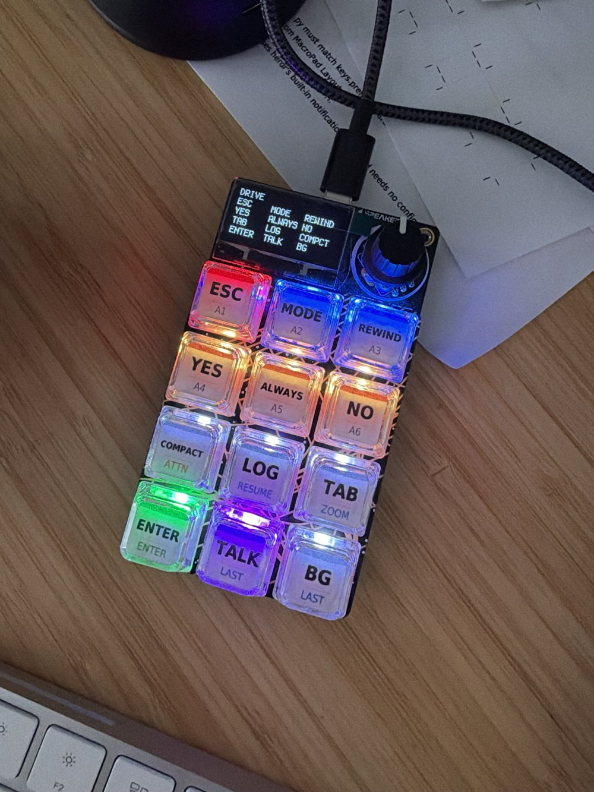

# vibe-macropad

A keypad for driving [Claude Code](https://claude.com/claude-code) from an Adafruit MacroPad RP2040, with status lights that show what each agent is doing.



The pad is a plain USB keyboard with two layers; press the encoder to switch between them.

- **DRIVE** sends keystrokes straight to Claude Code: ESC, MODE, REWIND, YES, ALWAYS, NO, TAB, LOG, COMPACT, ENTER, TALK (holds Right Option for voice) and BG.
- **FLEET** drives the herdr terminal multiplexer through its prefix key: A1–A6 jump to agents in herdr's sidebar order, plus ATTN, NEW, RESUME, ZOOM, LAST and ENTER. The encoder turns through agents on this layer and scrolls on DRIVE.

Each keycap carries both labels, DRIVE on top and FLEET below; `macropad-keycap-sheet.pdf` has the printable inserts.

## Tally

Tally lights the FLEET keys with each herdr agent's state: amber blinking when an agent needs you, green when it finished and you haven't looked, blue breathing while it works, dim white when idle. A Go CLI reads herdr's socket (read-only) and sends frames to the pad over a second USB serial port; the pad only renders them. The design is in [`Tally MacroPad Status Lights for Claude Code.md`](<Tally MacroPad Status Lights for Claude Code.md>).

```bash
go build -o ~/.local/bin/tally ./cmd/tally
tally status                         # herdr's agents in FLEET key order
tally status --json | tally frame -  # light the pad from live herdr state
```

## Layout

| Path | What it is |
| --- | --- |
| `MacroPad Layout Studio.html` | Browser app and source of truth for the keymap; it generates `code.py` and the matching herdr config. |
| `firmware/` | CircuitPython: `code.py` (generated), `boot.py`, `tally_link.py`, `render.py`. Copy all of them to the `CIRCUITPY` drive. |
| `cmd/tally`, `internal/` | The Tally CLI. |
| `keycap_sheet.py` | Renders the keycap PDF. |

## Development

```bash
go test ./...   # Go tests
uv run pytest   # firmware tests under CPython
```

Work follows GitHub Flow: branch, open a PR, merge with a merge commit.
