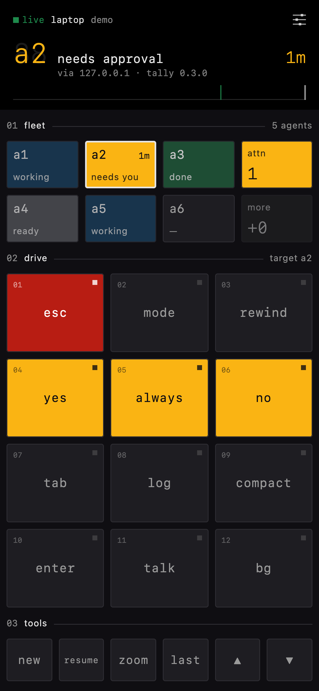

# tally

[](https://github.com/sroberts/tally/actions/workflows/ci.yml)
[](https://github.com/sroberts/tally/releases/latest)
[](https://goreportcard.com/report/github.com/sroberts/tally)
[](LICENSE)

**[sroberts.github.io/tally](https://sroberts.github.io/tally/)**

Running several Claude Code agents means constantly checking which one is waiting on you. tally puts your [herdr](https://herdr.dev) agents on a control pad: see at a glance which agent needs you, then approve, interrupt or dictate to it without switching windows. It runs in the background on the machine where herdr runs.

- **The browser pad** is the main way to use it: a pad on your phone's home screen, served by tally over HTTPS behind a password.
- **[vibe-macropad](https://github.com/sroberts/vibe-macropad)**, an Adafruit MacroPad on your desk, is optional. Its keys light by the same states, and it can run alongside the browser pad.



## Install

You need [Go](https://go.dev/dl/) 1.27 or later and a running herdr.

```bash
go install github.com/sroberts/tally@latest
```

That puts `tally` in Go's bin directory, usually `~/go/bin`. If your shell can't find it, add that directory to your `PATH`:

```bash
echo 'export PATH="$PATH:$(go env GOPATH)/bin"' >> ~/.zshrc   # or ~/.bashrc; then open a new terminal
```

No Go? Download the archive for macOS or Linux from [Releases](https://github.com/sroberts/tally/releases/latest), unpack it, and move `tally` into a directory on your `PATH`, such as `~/.local/bin`. On macOS, if you downloaded it with a browser, clear the quarantine flag first: `xattr -d com.apple.quarantine tally`.

**To update,** run the same `go install` (or download the new release), then `tally install-agent` again with the flags you first used, so the background agent restarts on the new version.

## Start it

Set up [Tailscale](#set-up-tailscale) first, then:

```bash
tally install-agent --web   # runs tally in the background, now and at login
```

This prints a generated password once and a QR code. Scan the code with your phone's camera to open the pad already signed in.

Using only the [hardware pad](#the-hardware-pad)? Plug it in and run `tally install-agent` without `--web`.

## The browser pad

### Set up Tailscale

1. Install Tailscale on the machine running herdr and on your phone, signed in to the same tailnet.
2. In the [admin console](https://login.tailscale.com/admin/dns), turn on **MagicDNS** and **HTTPS certificates**.
3. On Linux, also run `sudo tailscale set --operator=$USER` so tally can fetch its certificate without root.

tally fetches the certificate for `https://<machine>.<tailnet>.ts.net:47825/` itself within a minute, and renews it.

### Open it on your phone

1. **Scan the QR code** from `tally install-agent --web`, or run `tally web` for a fresh one. A code works once, for 15 minutes.
2. **Add it to the home screen** when the pad offers to. In Safari: Share → Add to Home Screen → Add. Then open **tally** from the home screen; it runs full screen and stays signed in.
3. If something's off, `tally doctor` should show `ok` on its `web`, `web password` and `web cert` lines.

### Use it

- **Tiles** show your agents. Tap one to focus it, swipe across them for the next or previous agent, and tap **attn** to jump to the agent that has waited longest.
- **DRIVE keys** (esc, mode, rewind, yes, always, no, tab, log, compact, enter, talk, bg) act on the agent named in the `02 drive` header. They light when they matter: the approval keys pulse when the agent needs you, and **enter** turns green when it's ready.
- **talk** opens a text box. Type, or dictate with the keyboard's mic. Return types the text into the agent, then **enter** sends it.
- **With a keyboard,** each key's letter works, plus Esc, Tab, Return, the arrows, `1`–`6` for tiles, `0` for attn and `t` for talk.

### Manage access

```bash
tally web                    # a fresh sign-in QR code
tally web --set-password     # pick your own password (12+ characters); signs every browser out
tally web --list             # signed-in browsers
tally web --revoke 3f9a01c2  # sign one out, or --revoke all
```

The pad always has a password, and the password never goes in a URL. Repeated wrong guesses are slowed down. Your agents' titles, paths and terminal output never leave the machine: the pad sees only each agent's state.

`--web-listen ADDR` narrows where the pad listens (default `:47825`).

### Keep your machine's name private

Tailscale's certificate comes from Let's Encrypt, and every such certificate is published in public [Certificate Transparency](https://certificate.transparency.dev) logs, so anyone can see your machine's `<machine>.<tailnet>.ts.net` name. To keep it out, tally can sign its own certificate instead. You trust tally's certificate authority once on each device that opens the pad. It still needs Tailscale and MagicDNS, but not HTTPS certificates.

1. **Switch tally to its own certificate:**
   ```bash
   tally install-agent --web --web-cert self
   tally web --ca          # writes tally-ca.cer here
   ```
2. **Trust the CA on your iPhone or iPad:** AirDrop `tally-ca.cer` to it and open it. Don't email it: it carries your machine's name, which this setup exists to keep private. Then go to Settings → Profile Downloaded → Install, and finally Settings → General → About → Certificate Trust Settings and turn on full trust for **tally CA for <your machine>**. Skip that last step and Safari warns before every visit, and the pad on your home screen gets stuck on the warning with no way past it.
   - **Mac:** `security add-trusted-cert -p ssl -k ~/Library/Keychains/login.keychain-db tally-ca.cer` trusts it for websites only. Keychain Access's **Always Trust** would trust it for mail and code signing too.
   - **Android:** Settings → Security → Encryption & credentials → Install a certificate → CA certificate.
3. **Scan the sign-in code** from `tally web`, as above.

tally renews the pad's certificate itself, about once a year, with nothing to redo on your devices. The CA can only vouch for websites at this machine's MagicDNS name, so even its key is no use for other sites, signed mail or IP addresses. If you rename the machine, tally makes a CA for the new name, and you trust that on each device; switch back and the old one still works. About nine years in, tally replaces the CA with a new one to trust. `tally doctor` warns two months ahead.

## The hardware pad

[vibe-macropad](https://github.com/sroberts/vibe-macropad) is an Adafruit MacroPad RP2040 with its own firmware. Plug it in over USB and tally finds it on its own, with or without `--web`. Its six agent keys and DRIVE keys light by the same rules as the browser pad, and its OLED shows the focused agent's state. It types into your agents through USB, so it acts on whichever window has focus; the browser pad acts on the agent directly.

If you never use the hardware pad, `--no-device` stops tally looking for it.

## Commands

| Command | Does |
| --- | --- |
| `tally install-agent [--web]` | Run tally in the background, now and at login |
| `tally uninstall-agent` | Stop and remove the background agent |
| `tally doctor` | Check herdr, the background agent, the browser pad and the hardware pad |
| `tally status` | List herdr's agents in slot order |
| `tally web` | Show a sign-in QR code for the browser pad |
| `tally web --ca` | Write tally's certificate authority to trust, for `--web-cert self` |
| `tally serve [--web]` | Run tally in this terminal instead of the background |
| `tally version` | Print tally's version |

`--no-device` skips looking for the hardware pad. Logs go to `~/Library/Logs/tally.log` on macOS and to the journal on Linux (`journalctl --user -u tally`).

## Agent states

Each agent is in one of five states. The pads share one palette, where amber always means "needs you". herdr's sidebar uses its theme's colors and the dot or symbol set by `ui.status_indicators` (dots by default, `symbols` for the second icon).

| State | Means | Browser pad | herdr sidebar | Hardware pad |
| --- | --- | --- | --- | --- |
| **Needs you** (`N`) | A permission prompt or question is waiting | Amber tile, pulsing, with the wait time; **attn** pulses. Focused: **yes**, **always** and **no** pulse, **esc** lights red | Red `●` / `×`, "blocked" | Amber key, blinking |
| **Done** (`G`) | Finished a turn you haven't looked at | Green tile. Focused: **enter** lights green | Teal `●` / `✓`, "done" | Green key |
| **Working** (`W`) | Running | Blue tile, breathing. Focused: **esc** lights red, **bg** blue | Yellow `●` / `◐`, "working" | Blue key, breathing |
| **Ready** (`R`) | Idle, and you've seen its result | Gray tile. Focused: **enter** lights green | Green `○`, "idle" | Dim white key |
| **Unknown** (`U`) | herdr can't tell yet | Dimmer gray tile | Gray `·`, "idle" | Faint white key |

An empty slot shows `—` on the browser pad and an unlit key on the hardware pad. The focused agent's tile has a white outline, and the others sit at 60%. DRIVE keys light by the focused agent's state, so the keys that matter right now stand out. When the link to tally drops, the tiles dim and the header says why.

`tally status` and the protocol docs use the one-letter codes.

## Contributing

Questions and setups go in [Discussions](https://github.com/sroberts/tally/discussions); bugs and ideas in [Issues](https://github.com/sroberts/tally/issues). See [`docs/developer.md`](docs/developer.md) for building, testing, the design docs and how changes land, and [`SECURITY.md`](SECURITY.md) to report a vulnerability privately.

## License

MIT; see [`LICENSE`](LICENSE).
